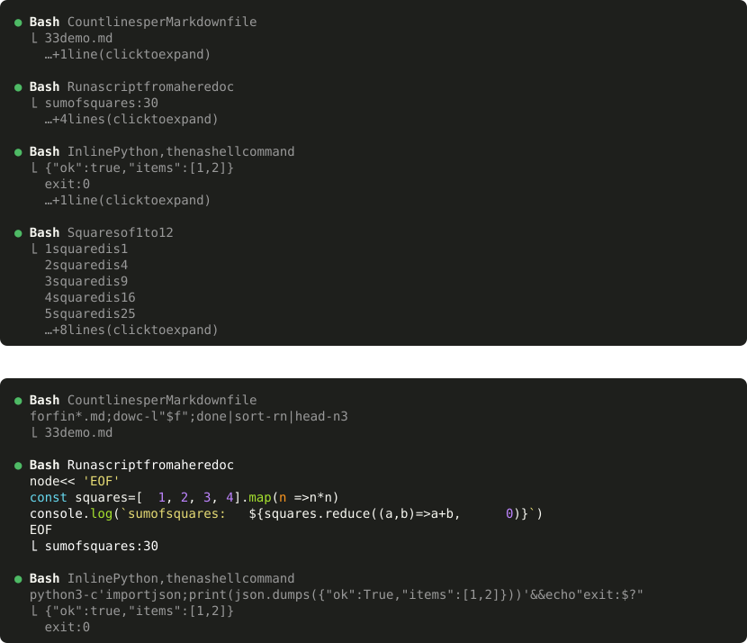

# shell-highlight

A [Claude Code](https://code.claude.com) mod that draws `Bash` and `PowerShell` tool calls with syntax-highlighted commands, makes paths and URLs in shell calls, tool rows and Claude's replies clickable, lets you read along with what `Read` read, and can draw every tool call as one line or not at all.



The picture shows an earlier version, which drew the commands of a folded run; this version hides them until the run is unfolded.

Claude Code prints a shell command in one colour and folds a run of them into a count line (`Ran 4 shell commands`). This mod draws a folded run as the description of each call with the first lines of its output underneath; a click unfolds the run and shows each command, coloured by Claude Code's own highlighter.

## Features

- **Highlighted commands, under the pointer.** `Bash` calls are coloured as bash, `PowerShell` calls as PowerShell. In the fullscreen terminal a shown command stands in one dim colour and takes its colours while the pointer is over its call, without moving a line; a call too large to be drawn twice is coloured at once. Everywhere else (the classic transcript, the desktop app, VS Code, mobile) it is coloured at once.
- **Embedded languages.** A script handed to an interpreter is coloured in its own language, whether it sits in a heredoc, a PowerShell here-string or a quoted argument:

  | Written as | Coloured as |
  | --- | --- |
  | `node -e '…'`, `node <<'EOF'`, `bun`, `deno`, `tsx` | JavaScript / TypeScript |
  | `python -c '…'`, `python3 <<'EOF'`, `py` | Python |
  | `ruby -e`, `perl -e`, `php -r` | Ruby, Perl, PHP |
  | `psql`, `sqlite3`, `mysql` with a heredoc | SQL |
  | `bash -c '…'`, `sh -c`, `zsh -ic '…'` | bash |
  | `pwsh -Command '…'`, `powershell -c` | PowerShell |
  | `cmd /c "…"` | batch |
  | `cat > script.py <<'EOF'`, `@'…'@ \| Set-Content data.json` | by the file's extension |

- **Commands folded away, one click to show them.** A folded run of calls shows each call's description and up to 5 lines of its output, then `… +N lines (click to expand)`, which counts the hidden lines of the command and of the output. A click anywhere on the run unfolds every command and every line of output; a second click folds them again. A call without a description shows only its tool name until it is unfolded.
- **A call on its own.** A shell call that Claude Code draws as a row of its own, outside a run, shows its description and `(click to show)` in the fullscreen transcript; a click shows the command and turns the label into `(click to fold)`. Outside fullscreen and in the `ctrl+o` transcript such a row always shows its command, as does every row of an unfolded run.
- **Hover per call.** The pointer lights up the description and output of the call under it, not the whole run.
- **Wrapping that keeps the colours.** A command line wider than the terminal is wrapped at a space, outside string literals where there is one, else inside them, and a word too long for any line is cut, starting right after the text before it, so every wrapped line is still highlighted. A line with characters of unsure width (combining accents, emoji sequences) is left to Claude Code to wrap. Wide characters (CJK, emoji) count as two cells.
- **Status at a glance.** The dot is dim while a call runs, green when it succeeded, red when it failed or was interrupted. An interrupted call says `Interrupted`; where the mod draws the output, a running call says `Running…` and a silent one `(no output)`.
- **Clean output.** Colour codes and control characters are removed from the output; in a command they are shown as visible symbols (`␛`).
- **Clickable paths and URLs.** Absolute paths (`C:\…`, `\\server\…`, `/a/b…`, `~/…`) and `http(s)://` URLs are links in shell commands and shell output, as are the targets in the `Read`, `Update`, `Write` and `Fetch` rows; in Claude's replies paths become links too (URLs there are links already). In fullscreen one click hands the target to the system's opener (`explorer.exe` on Windows, `xdg-open` or `open` elsewhere), as a double-click in a file manager would: a document opens in its program, a URL in the browser, and a program, script or shortcut that runs on a double-click (`.exe`, `.bat`, `.cmd`, `.lnk` and the like) is started. A Windows folder is opened by a short PowerShell script that waits for its Explorer window and brings it to the front, sending one press and release of Alt so that Windows lets it. A path wrapped over two lines is clickable on both.
- **Read along.** In fullscreen, `Read 12 lines (click to show)` unfolds the lines that were read, highlighted by the file's extension, numbered from where the read started; a second click folds them. `.output`, `.log`, `.txt` and extension-less files are coloured by their content when it is JSON, XML or a shell session. In an unfolded run the lines show at once. Only a click in fullscreen or an unfolded run shows them, in the `ctrl+o` transcript as well; the classic transcript shows `Read 12 lines` only.
- **Everything else stays native.** In the full view, tools other than the shell tools, `Read`, `Edit`, `Write` and `WebFetch` keep Claude Code's rows, Claude Code draws the result blocks except `Read`'s and those whose output a row of an unfolded run already drew, and a reply without paths is Claude Code's. A run that mixes shell calls with other tools keeps its count line (`Read 1 file, ran 2 shell commands`) above the shell calls and unfolds into the engine's own rows.
- **Three views of tool calls.** `full` draws calls as described here; `one line` draws every call, of any tool, as one line (name and description or main argument) without output; `off` draws no calls at all, except one that is still running, which keeps its line until it ends. The `ctrl+o` transcript always shows every call in full, except the lines a `Read` read, which appear there only after a click in fullscreen or in an unfolded run. The current view is the dim `🔧 tools: full` button the mod adds to the hint line under the prompt; a click on it, or `/tool-view`, switches to the next. The view lasts for the session.
- **A key for the views.** `/tool-view` can be bound like any command, here to `ctrl+x v`, in the `Chat` block of `~/.claude/keybindings.json`: `"ctrl+x v": "command:tool-view"`.

### Where the output comes from

| View | Command | Output |
| --- | --- | --- |
| Fullscreen transcript, folded run | hidden, counted in `… +N lines` | this mod, 5 lines |
| Fullscreen transcript, run unfolded by a click | this mod | this mod, all lines |
| Fullscreen transcript, call on its own | this mod, after a click on `(click to show)` | Claude Code |
| Detailed transcript (`ctrl+o`) | this mod | Claude Code, all lines (this mod for a run unfolded before); the lines of a `Read` only after a click in fullscreen or in an unfolded run |
| Classic (non-fullscreen) transcript, call on its own | this mod | Claude Code, folded, `ctrl+o to expand` |

A folded run in the classic transcript is drawn as in fullscreen, its count line ending in `(ctrl+o to expand)`.

The fold of a run belongs to Claude Code: a click unfolds the run of consecutive calls it sits in, and the state lasts as long as Claude Code keeps it. The `(click to show)` of a call on its own is the mod's, kept in its session state like the unfolded reads.

### Links and your terminal

Claude Code writes links as OSC 8 hyperlinks only in terminals it recognises; elsewhere it prints the URL after the text, which doubles every path and breaks at a line wrap. If that happens, set `"FORCE_HYPERLINK": "1"` in the `env` block of `~/.claude/settings.json` and restart Claude Code.

A single click reaches the mod only in the fullscreen transcript. In the classic transcript the terminal handles the click itself, as with any hyperlink, and in fullscreen it handles a ctrl- or alt-click on a link.

Known limits: a path with spaces is linked up to the first space, relative paths are not linked, a click on a link inside an unfolded run also folds the run, and WezTerm underlines only the line under the pointer of a wrapped link.

## Requirements

Claude Code **2.1.287 or newer**, the first version with mods (function hooks). This version of the mod was checked on 2.1.321 and 2.1.323 only (see [Tested](#tested)); whether every part of it works on an older build is not checked. The mods API is early access and may change between releases.

## Install

```sh
git clone https://github.com/Turbo-Thorschten/shell-highlight.git
claude --plugin-dir ./shell-highlight
```

To load it in every session, name the folder in `CLAUDE_CODE_PLUGIN_DIRS`, either in your environment or in the `env` block of `~/.claude/settings.json`:

```json
{
  "env": {
    "CLAUDE_CODE_PLUGIN_DIRS": "~/path/to/shell-highlight"
  }
}
```

The variable is a list. To keep other mods, append the folder with your platform's path-list separator: `;` on Windows, `:` on Linux and macOS.

Open `/plugin` to check: the header reads `N mods active · shell-highlight, …`.

## How it works

Two files: [`hooks/text.ts`](hooks/text.ts) splits a command into pieces, their languages and their links, and [`hooks/register.ts`](hooks/register.ts) draws them from `ui.render` hooks.

1. **`ToolGroup`**, a run of calls. Folded, the hook draws each shell call itself: its description and the start of its output, without the command. Unfolded, it hands the run to Claude Code, which draws every call as a row.
2. **`ToolUse`**, one row. For a shell call the hook draws the highlighted command, behind `(click to show)` for a call on its own in fullscreen; for `Read`, `Edit`, `Write` and `WebFetch` the name and a linked target (in an unfolded run only for `Read`, with the lines read). A row of an unfolded run also draws its output, because Claude Code draws a run's output inside the row the hook replaces.
3. **`ToolResult`**, the result block under a row. Left to Claude Code, except where the row already drew the output and for `Read`, whose line count unfolds the lines read.
4. **`AssistantMessage`**, a block of a reply. A block with paths is drawn by the mod, with the paths as links; any other block is left to Claude Code.
5. **`PromptHint`**, the hint line under the prompt. The mod adds its view button after what Claude Code draws there.

In the `one line` and `off` views the first three hooks draw every call themselves and leave the result blocks empty, except in the `ctrl+o` transcript, where they draw as in the `full` view. The colours under the pointer are a second, coloured copy of each command piece, laid over the dim one and revealed by a hover; both copies come from the same pieces, so they wrap alike.

The mod does not touch tool calls: the command that runs, its permission prompt and its result are untouched. Besides drawing, it registers `/tool-view`, and a click on a link starts the opener described above. `claude plugin validate` lists its engine calls: `$.ui.resolve` and `$.ui.toast` for drawing, `$.state` for the unfolded reads and commands and the view, `$.command.register` for `/tool-view`, `$.env.get` (`USERPROFILE`, `HOME`) to expand `~`, and `$.fs.stat` (is a Windows path a folder?) and `$.process.run` (the opener, or PowerShell for a folder) only when you click a link. It makes no network requests of its own (`$.http` is not used), but a click can reach the network: a URL opens in the browser, and a UNC path (`\\server\…`) makes Windows contact that server, first for the folder check and then to open it.

It runs next to other mods. For a row or reply it draws itself (shell rows, the `Read`, `Edit`, `Write` and `WebFetch` rows, replies with paths, every call in the `one line` and `off` views) it returns its own drawing, so a mod loaded beneath it does not draw that row.

## Tested

The behaviours above were checked on a real screen, except where this section says otherwise. All but the links, `Read` unfolding, the colours under the pointer, the views and the hidden commands were checked on Claude Code 2.1.287:

- Windows 11 in WezTerm, `Bash` and `PowerShell` tools
- Linux (Ubuntu under WSL 2) in tmux, fullscreen and classic mode, at 110 and 50 columns
- pointer hover and clicks, the `ctrl+o` transcript, a running, a failed, an interrupted and a not yet approved call, 3,000 lines of output, a second mod loaded alongside

Links and `Read` unfolding were checked on Claude Code 2.1.291: clicks on paths in tool rows, shell commands and replies in WezTerm on Windows, and a folder's Explorer window coming to the front. They were not checked in the desktop app, VS Code or on mobile.

The colours under the pointer and the three views were checked on Claude Code 2.1.321, the Windows build in tmux under WSL 2 at 100 columns: a dim command and the same rows coloured under the pointer, for one call only, with a long, a multi-line and an inline-script command; commands coloured at once in the classic transcript; the footer label, `/tool-view` and the `ctrl+x v` binding cycling the views; `one line` and `off` on shell, `Read` and `Glob` calls, a failed one and a running one; `ctrl+o` in `off`; `one line` and `off` in the classic transcript, a permission prompt in `off`, a tab in a command; an unfolded call with 109,000 characters of output, coloured at once. Not checked: a click on a link in a dim command, and the desktop app, VS Code and mobile.

The hidden commands were checked on Claude Code 2.1.321, the Windows build in tmux under WSL 2, fullscreen, at 110 columns: folded runs of reading, writing, failing and background `Bash` calls showing their descriptions, the start of their output and `… +N lines`, with `+1 line` for a one-line command; a click unfolding a run, every command shown, one of them checked to be dim and coloured under the pointer; every command shown in the `ctrl+o` transcript, without a toggle. On that build every shell call tried was folded into a run, so a call on its own was not seen in the transcript. Its `(click to show)` was pressed only in a test copy of the mod that also drew it in the `ctrl+o` transcript, where a click showed the command and a second one hid it again. Not checked for the hidden commands: the classic transcript, the `PowerShell` tool, the desktop app, VS Code and mobile. The cut of a word too long for any line, which now starts right after the text before it, was checked by the tests only.

The search results beside shell calls were checked on Claude Code 2.1.323, the Windows build in tmux under WSL 2, fullscreen, at 110 columns: a run of a `Glob` and a `Bash` call, unfolded by a click, shows the search result and the command's output once each, and the `ctrl+o` transcript after it shows them once each too, the search result included. Checked by the tests only: that a folded run shows up to 5 lines of output (with 5, 6 and 7 lines), where a call becomes too large to be drawn twice, and that an opener exiting with an error (`xdg-open`, `open`) hands the target to the next one or ends in `Could not open …`. That the lines of a `Read` show in the `ctrl+o` transcript only after a click or in an unfolded run follows from the code and was not checked on a screen.

`claude plugin test` runs 127 tests of the splitting, wrapping, linking and drawing and of the views, on the terminal and desktop surfaces.

## Development

```sh
claude plugin validate .    # what the module hooks and calls, and anything the engine would refuse
claude plugin test .        # runs tests/*.test.ts
npx -p typescript tsc -p .  # type-check; needs .claude-plugin/types/, which Claude Code writes when it loads the mod
```

## License

[MIT](LICENSE)
